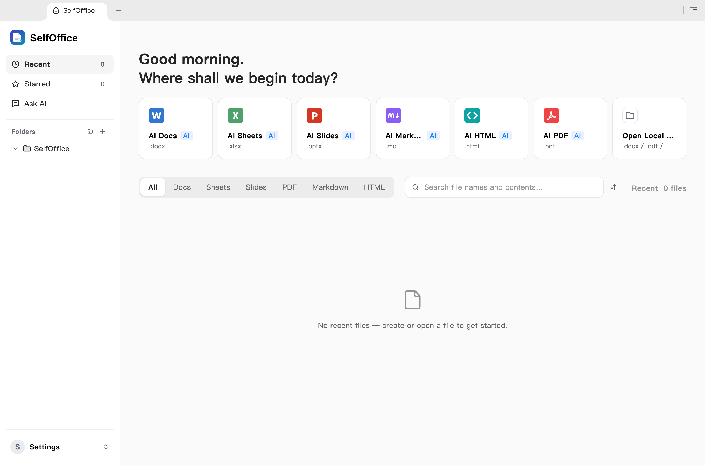

<h1 align="center">SelfOffice</h1>

<p align="center"><b>A self-hosted, bring-your-own-model AI Office suite.</b><br>
Word, Excel, PowerPoint and PDF files, edited by you and your AI, saved back in the real formats.</p>

SelfOffice is a fork of [GenOffice](https://github.com/genspark-ai/genoffice)
(Apache-2.0, © Mainfunc, Inc.) with every Genspark-hosted dependency removed:
no Genspark sign-in, no Genspark LLM proxy, no cloud tools, no usage analytics.
Models and tools are yours: your Claude subscription, your API keys, or your
own server.

<p align="center"></p>

## Why SelfOffice

- **Open source**, Apache-2.0, built in the open on GitHub.
- **Yours to run.** Native apps for macOS, Windows and Linux; files stay on your
  disk and every edit, save and conversion happens on your machine.
- **Real Office files.** Native `.docx`, `.xlsx` and `.pptx`, byte-preserving:
  the parts of a file you did not touch are copied exactly as they were.
- **An AI that edits the document itself.** Tracked changes in Docs, live
  formulas and charts in Sheets, slides drawn onto the canvas, every AI turn a
  snapshot you can roll back.
- **Your model, your key.** Use your Claude subscription, or bring a key for
  OpenAI, Gemini, DeepSeek and more, local servers and any OpenAI-compatible
  endpoint included.
- **PDF done properly.** Edit text inside the page, and convert PDF to Word,
  Excel or PowerPoint on-device, with system OCR for scans.
- **Markdown and HTML too**, with the same AI panel and local export to Word.
- **Search that finds the answer, not the keyword.** Full-text search over
  every document in your folders, indexed on-device, with optional reranking
  by TypeSafe Jev, the System One judgment model.
- **Ask AI across your files.** Star the files that matter and ask questions
  in plain language; every answer cites the file it came from, one click away.
- **Skills.** Ready-made skills, or your own `SKILL.md`, attached from
  the **+** menu of any AI panel.
- **Scriptable.** A `selfoffice` command line, an agent skill and an MCP server
  put every engine at the service of Claude Code, Claude Desktop, Codex, Cursor
  and other agents, still on-device.
- **Free**, for individuals and teams alike.

## AI backends

Settings → AI lets you pick one of:

- **Claude (subscription)**: runs `claude -p` with your logged-in Claude Code
  subscription (`claude login` once). The CLI is found through your login shell's PATH,
  so installs behind mise, nvm or volta work. No API key, no tools, no project
  context are handed to the CLI; it is only used as a text model. Models: `sonnet`
  (default), `opus`, `haiku`. Note: `--bare` is not used because bare mode
  ignores the OAuth login.
- **Codex CLI**: your ChatGPT/Codex login through the Codex app-server.
- **Bring your own key**: Claude, OpenAI, Gemini, DeepSeek, Kimi, GLM, Qwen,
  Doubao, MiniMax, Grok, Mistral, OpenRouter, Requesty, Opper, Cheaper
  Inference, Atlas Cloud and OpenCode Zen/Go.
- **Custom**: any OpenAI-compatible endpoint (base URL + optional key),
  including local servers such as Ollama, LM Studio or vLLM.

Search and media have their own per-capability providers under **AI Media &
Search**. Web search works out of the box (free keyless chain: Parallel Search
MCP, then DuckDuckGo); Serper, Serply, Tavily, Parallel, Keenable, Exa or
Firecrawl are optional keyed upgrades. Image generation and image/video
analysis are **off until you configure a provider** (OpenAI, Gemini,
Doubao/Seedream, GLM, Grok, Qwen, MiniMax or any OpenAI-compatible images
endpoint).

The whole suite ships light, dark and system themes. Themes only change what
is on screen: exports, prints and saved files always keep the document's own
colors.

## OpenDocument (ODF)

`.odt`, `.ods`, `.odp` (and the `.ott`, `.ots`, `.otp` templates) open and save **in place**, locally, with no office suite installed:

- **Open:** the file is imported once into an OOXML working copy (kept in the app's data folder) that the Docs, Sheets and Slides editors edit; the tab keeps the ODF name.
- **Save:** every save is _patched_ into the original ODF file. Only the paragraphs, cells or slides you touched are rewritten; everything else, including comments, tracked changes, charts, animations, styles and settings, stays byte-identical. If a patch is ever impossible the previous file is backed up and a full export is written instead, and you are told.
- **Convert:** `selfoffice convert report.docx --to odt` (also `xlsx → ods`, `pptx → odp`, and back). Right-click a tab → **Export as OpenDocument…** writes a copy of a saved OOXML file.
- Known limits: content inside a rewritten block loses what the editor does not model (reported per block); sheets with inserted rows or changed column widths are re-serialized as a whole sheet; if another program changes the `.odt` while it is open, SelfOffice refuses to overwrite it and tells you when you open it again (close the tab and reopen to load the new version).

## Skills

A skill is a `SKILL.md` that tells the AI how to do one job well: a weekly
report, an NDA, a lesson plan. SelfOffice ships a set of them and takes your own,
in the same format coding agents use.

- **Settings → Skills.** **Install** a recommended skill, or **Import** a
  folder, a zip or a single `SKILL.md`. Nothing runs on import.
- **In a chat.** Open the **+** menu next to the composer of any AI panel,
  pick **Skills**, tick one, send. The skill goes along with that message only.

---

## Command line and agent skill

Everything the apps can do to a file, the `selfoffice` command line can do from
a terminal: inspect, convert, create, read and edit Word, Excel, PowerPoint,
PDF, Markdown and HTML on the same engines, headless. It installs with
SelfOffice, needs no runtime of its own, and never sends a document anywhere.
Paired with the bundled **agent skill**, it turns a coding agent into a
document worker that produces real Office files instead of Markdown
approximations.

**Works with:** Claude Code, Codex, Cursor, Gemini CLI, GitHub Copilot,
OpenCode and Windsurf out of the box, any other agent that reads skills, and,
through the [MCP server](#mcp-server), Claude Desktop and every MCP client.

### Install the skill

| How                                    | What happens                                                                                                                                                              |
| -------------------------------------- | ------------------------------------------------------------------------------------------------------------------------------------------------------------------------- |
| **Settings → Integrations** in the app | Lists the agents found on this computer; one click writes the skill into each one you choose. An **Update** button appears when a SelfOffice release ships a newer skill. |
| **Download as zip** on the same page   | The layout claude.ai, the Claude desktop apps and other assistants accept as an uploaded skill.                                                                           |
| `npx skills add tcsenpai/selfoffice`   | Installs from this repository into any skills-compatible agent.                                                                                                           |

Then start a new chat and ask for a document. The skill teaches the agent when
to reach for `selfoffice`, how to read a file before editing it, and how to
check its own work.

### Quickstart from the terminal

```bash
selfoffice --version
selfoffice info report.docx --json                  # headings and blocks; or sheets, slides, pages
selfoffice convert report.md --to pdf               # md/html/docx/xlsx/pptx → pdf, pdf → docx/xlsx/pptx/md/html, odt/ods/odp → docx/xlsx/pptx and docx/xlsx/pptx → odt/ods/odp, …
selfoffice create --type docx --from notes.md --out notes.docx
selfoffice create --type xlsx --from table.json --out sales.xlsx   # "=SUM(B2:B9)" cells stay live formulas
selfoffice docs read report.docx --range 0-9 --json # then `docs apply --ops edits.json` edits in place
selfoffice docs compare original.docx revised.docx --out redline.docx   # the differences as tracked Word revisions
selfoffice render report.docx --out shots/          # one PNG per page, to look at what you made
selfoffice open sales.xlsx                          # hand the result to the editor
```

Every command prints a one-line summary, or a single JSON object with
`--json`. Edits are atomic: a rejected op leaves the file untouched and comes
back with a guided error. `selfoffice help` lists the current command surface;
the full reference is [packages/cli/README.md](packages/cli/README.md).

### What the agent actually runs

The Solar System deck in the [demo](#demo) took one prompt in Claude Code.
Behind it, the agent followed the skill's staged workflow and the CLI checked
every stage before the next one started:

```bash
selfoffice capabilities --json                        # which cloud tools SelfOffice has configured
selfoffice guide slides design                        # the deck workflow and layout library
selfoffice image "the eight planets in a row …" --aspect 16:9 --out deck/assets/cover.jpg
selfoffice slides check deck/outline.json --json      # 8 pages, no findings
selfoffice slides check deck/pages/01.json --json     # builds one slide, audits overflow and overlap
…                                                    # one page file per slide, fixed until each check is clean
selfoffice create --type pptx --spec deck/pages --outline deck/outline.json --out deck/solar-system.pptx --json
selfoffice slides render deck/solar-system.pptx --out deck/shots --json
selfoffice slides audit deck/solar-system.pptx --json    # 8 slides, no layout issues
selfoffice slides replace deck/solar-system.pptx --slide 4 --spec deck/pages/05.json --json
selfoffice open deck/solar-system.pptx
```

No model call happens inside `selfoffice`: the agent does the thinking, the CLI
does the building and the checking, and the result opens in SelfOffice or
PowerPoint as an ordinary `.pptx`.

### MCP server

The same commands are available as [Model Context Protocol](https://modelcontextprotocol.io)
tools, for assistants that cannot run a terminal or that you would rather not
give one. There are two ways in, both shown with copy-ready snippets in
**Settings → Integrations → MCP**:

| Way                                    | What it is                                                                                                                                                                                                                                                                                                                                                                                                                                                                                    |
| -------------------------------------- | --------------------------------------------------------------------------------------------------------------------------------------------------------------------------------------------------------------------------------------------------------------------------------------------------------------------------------------------------------------------------------------------------------------------------------------------------------------------------------------------- |
| **A · `selfoffice mcp`** (recommended) | A stdio server the assistant starts itself; SelfOffice does not need to be open. One tool per command (`info`, `convert`, `create_docx`, `create_xlsx`, `create_pptx`, `create_pdf`, `docs_read` / `docs_apply` / `docs_check`, `sheet_*`, `slides_*`, `render`, `guide`, `search`, `image`, `media`, `open`) plus the staged deck flow `deck_start` → `deck_page` → `deck_build` → `deck_replace`. Ops, specs and Markdown are passed inline, so a client without a file system still works. |
| **B · Local HTTP server**              | Runs inside the SelfOffice app on `http://127.0.0.1:3093/mcp` (Streamable HTTP, with legacy SSE). Its tools drive a visible Word editor tab: `create_session`, `insert_content`, `replace_blocks`, `apply_ops`, `read_document`, `save_session`, and you watch the document take shape. Off by default; switch it on in the same settings pane.                                                                                                                                               |
| **C · `selfoffice mcp --http`**        | The stdio tool set as a Streamable HTTP server for clients on other machines: a container, a sandbox, a shared box on your network. Files travel with the calls: `PUT /files/<name>` uploads one and returns a URL, every `file` parameter takes an http(s) URL, and a tool that writes a file hands it back as a download URL plus, when small, the bytes as an MCP resource. `--host 0.0.0.0` opens it to the network, `--token` protects it.                                               |

```bash
# Claude Code
claude mcp add --transport stdio selfoffice -- selfoffice mcp
```

```jsonc
// Cursor, Claude Desktop or any other MCP client
{ "mcpServers": { "selfoffice": { "command": "selfoffice", "args": ["mcp"] } } }
```

```bash
# On the machine that has SelfOffice (private network; add --token for a shared box)
selfoffice mcp --http 3093 --host 0.0.0.0 --token "$SELFOFFICE_MCP_TOKEN"

# From the client: upload, then use the URL wherever a tool takes a file
curl -T report.docx -H "Authorization: Bearer $SELFOFFICE_MCP_TOKEN" http://server:3093/files/
#   → { "url": "http://server:3093/files/<id>/report.docx", ... }
#   docs_read({ "file": "http://server:3093/files/<id>/report.docx" })
#   docs_apply(...) → output_url, downloadable with curl -o
```

Over HTTP every session gets a private scratch folder, relative paths and deck
folders resolve inside it, `open` is not offered, and with
`SELFOFFICE_ALLOWED_ROOTS` unset the tools cannot leave the server's own file
store. `render`, `convert` to PDF and `create_pdf` still start a hidden
SelfOffice process, so a headless host needs the app installed and a virtual
display (`xvfb-run`).

`selfoffice` here is the CLI shipped inside the app (on macOS
`/Applications/SelfOffice.app/Contents/Resources/cli/selfoffice`; the settings
pane prints the exact path for your install). The server carries its own
workflow instructions and exposes the op references as `selfoffice://guide/*`
resources, so no skill is needed; the skill and the MCP server can coexist and
the assistant picks one. Cloud features (`search`, `image`, `media`) still go
through the provider configured in SelfOffice; everything else runs locally, and
`SELFOFFICE_ALLOWED_ROOTS` confines every tool to the folders you list.

The renewable-energy deck in the [demo](#demo) is what one prompt in Claude Code
with only the `selfoffice` MCP server attached looks like from the protocol
side:

```text
capabilities · guide(slides, spec) · guide(slides, design)
search(query) ×4                         → IEA, BNEF and IRENA figures for the slides
search(query, images) ×7 · media(url, ask) ×7
                                         → candidate photos, each one checked to be a real photograph
deck_start(dir, style, outline)          → outline checked: 8 pages to write
deck_page(dir, 0, page) … deck_page(dir, 7, page)
                                         → each page checked against the outline and the palette; one page sent again
deck_build(dir, out)                     → renewables-2026.pptx, no image failures
slides_audit(file) · slides_render(file, out)
                                         → no layout findings; 8 PNGs come back as image content
deck_replace(dir, n, page) ×3 · slides_render(file, out)
                                         → three pages fixed after looking at the renders
```

Thirty-eight calls, about thirteen minutes, and the assistant never touched a
shell: the figures, the photos, the guides, the checks and the renders all
travelled as MCP tool results. Only `search` and `media` left the machine, to
the provider configured in SelfOffice.

## How it works

Seven Electron apps — Docs, Sheets, Slides, PDF, Markdown, HTML and the
tabbed shell — share one engine layer of pure TypeScript packages plus a Rust
sidecar for `.xlsx`. The original file is always the source of truth: edits
are applied as narrow patches, and everything the editor did not touch
survives the round trip untouched.

```
open docx ─► archive original by hash (never touched)
          ─► parse word/document.xml into a block tree, each block anchored to its original XML
          ─► Tiptap editor (manual + AI editing, dirty tracking)
save      ─► dirty blocks → OOXML fragments (referencing existing styles only)
          ─► splice into the original document.xml; untouched blocks keep their bytes
          ─► repack the zip; every other entry is copied byte-for-byte
```

The package-by-package tour (docx/pptx engines, `pdf2docx`, `html2docx`, the
agent core and providers) lives in [CONTRIBUTING.md](CONTRIBUTING.md#engine-packages).

## Development

```bash
npm install
npm run fixtures     # generate test .docx fixtures
npm test             # engine + app unit tests (docs/sheets/slides need no display)
npm run typecheck    # tsc --noEmit across every workspace
npm run dev          # all six editors + shell against Vite dev servers
npm run dev:docs     # a single app (same pattern works per workspace)
npm run dist:mac     # package macOS dmg (regenerates third-party notices)
npm run dist:win     # package Windows nsis installer
npm run dist:linux   # package Linux AppImage + deb + rpm
```

The sheets app additionally needs a Rust toolchain for its xlsx sidecar
(`cargo` on PATH); `npm run build -w @selfoffice/sheets` compiles it
automatically. See [CONTRIBUTING.md](CONTRIBUTING.md) for the checks every
change must pass and how pull requests land.

## Security

See [SECURITY.md](SECURITY.md) for the process security posture (renderer
sandboxing, IPC validation, external-link gating) and the threat models for
AI-generated content.

## Acknowledgements

SelfOffice would not be possible without these open-source projects:

- [Electron](https://www.electronjs.org/) — the desktop runtime for every app.
- [Univer](https://github.com/dream-num/univer) (Apache-2.0) — the spreadsheet
  UI core that Sheets extends.
- [PDFium](https://pdfium.googlesource.com/pdfium/) (BSD-3-Clause, bundled via
  [@embedpdf/pdfium](https://github.com/embedpdf/embed-pdf-viewer)) — the
  content-stream engine behind true PDF text and image editing.
- [pdf.js](https://github.com/mozilla/pdf.js) (Apache-2.0) and
  [pdf-lib](https://github.com/Hopding/pdf-lib) (MIT) — PDF rendering and
  document assembly.
- [Tiptap](https://tiptap.dev/) / [ProseMirror](https://prosemirror.net/) —
  the block editors in Docs and Markdown.
- [CodeMirror](https://codemirror.net/) (MIT) — the source editor in HTML.
- [Konva](https://konvajs.org/) — canvas rendering for Slides and Sheets
  charts.
- [HarfBuzz](https://github.com/harfbuzz/harfbuzz) (wasm) — text-shaping
  metrics for complex scripts.
- [calamine](https://github.com/tafia/calamine) and
  [IronCalc](https://github.com/ironcalc/IronCalc) — the read and calc layers
  of the Rust xlsx sidecar.
- [libeot](https://github.com/umanwizard/libeot) (MPL-2.0) — the MicroType
  Express decoder for embedded PowerPoint fonts, ported to TypeScript.
- [React](https://react.dev/) (MIT) — the UI layer of every app.
- [Mermaid](https://mermaid.js.org/) (MIT) and [KaTeX](https://katex.org/)
  (MIT) — diagrams and math in Markdown and Docs.
- [opentype.js](https://opentype.js.org/) (MIT) — font parsing for metrics
  and glyph lookup.
- [JSZip](https://stuk.github.io/jszip/) (MIT) and
  [fast-xml-parser](https://github.com/NaturalIntelligence/fast-xml-parser)
  (MIT) — the OOXML container and XML layers.
- [Fluent UI System Icons](https://github.com/microsoft/fluentui-system-icons)
  (MIT) — the icon set across the ribbons.
- [electron-updater](https://www.electron.build/) (MIT) — in-app updates.
- Liberation, Carlito, Caladea, and Noto CJK fonts (OFL/Apache-2.0) — bundled
  document fonts.

`npm run notices` regenerates the bundled third-party license summary
(`tools/gen-third-party-notices.mjs`); all runtime dependencies are
MIT/Apache-2.0/BSD-3-Clause/OFL.

## How this fork is maintained

This repository is automated and maintained mainly by an AI (Claude Code), with a
human in control. Twice a day a workflow merges what
[GenOffice](https://github.com/genspark-ai/genoffice) published upstream, re-applies
the SelfOffice changes (no hosted services, your own models, OpenDocument support),
runs the full test suite and, when everything is green, ships a new release. Changes
that touch what this fork removed (Genspark services, analytics, sign-in, cloud) or
that fail CI are never merged automatically: they wait for a person to review them.
The human maintainer reviews flagged changes, owns the decisions, and can pause the
automation at any time. Details for maintainers are in [CONTRIBUTING.md](CONTRIBUTING.md).

## License

SelfOffice is licensed under the [Apache License 2.0](LICENSE), as is upstream
[GenOffice](https://github.com/genspark-ai/genoffice) (© Mainfunc, Inc.). The
upstream copyright and license notices are kept, and this fork's modifications
are listed in [NOTICE](NOTICE). The License and NOTICE ship inside every
installer.

The `ee/` directory is not Apache-2.0: it carries upstream's separate
[GenOffice Enterprise License](ee/LICENSE) (development and testing use only;
production use or redistribution needs an agreement with Mainfunc, Inc.). Today
it holds only that license text and a README, so this repository contains no
Enterprise Software, and none is built into or distributed with SelfOffice.
Anything upstream later adds under `ee/` is deliberately not merged into this
fork.
